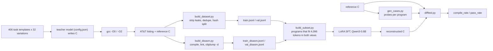

<div align="center">


# kind_picture

### Teaching a 0.6B model to read x86-64 assembly and write back working C


**A narrow, mechanically verifiable code model that runs on a laptop.**

[Pipeline](#pipeline) · [Results](#results) · [Quick start](#quick-start) · [Roadmap](#roadmap) · [Docs](#docs)

</div>

---

> **Status (2026-10-24):** the input format now has a disassembly twin, and two
> adapters are training on it — listings only and disassembly only, on the same
> 3,876 programs and the same split. Results follow when the runs finish.
>
> **Previous result (2026-10-23):** on a 118-pair validation split the adapter
> compiles **70.3%** of the answers; **27.1%** of them reproduce the reference
> behavior when each program is tested on its own probes, **22.9%** when every
> program is tested on one fixed list of ten inputs. On the 26-pair subset
> shared with the earlier runs it reaches **84.6%** and **23.1%**, against
> 73.1% / 0% for the previous adapter and 26.9% / 0% for the base model. A
> do-nothing program scores 5.1% on the fixed list and 0% on per-program
> probes, so the metric no longer pays for empty answers. Numbers are reported
> as they are.
>
> **Finding — the model is trained on a format it will not meet.** The input
> was a `gcc -S` listing: symbolic labels, no addresses, no instruction bytes.
> In practice a company has a binary and nothing else, and assembly comes out
> of a disassembler (`objdump -d`), which prints virtual addresses, hex bytes,
> `call 401030 <printf@plt>` and RIP-relative operands. Every record keeps its
> `c_source`, so the second corpus is a re-derivation of the same programs, not
> a new collection: `build_disasm.py` compiles the stored C, links it, and
> keeps only the functions the program itself defines.
>
> **Finding — the disassembly costs twice the tokens.** The hex-byte column and
> the addresses tokenize poorly: the median pair is 4,475 tokens against 2,259
> for the listing, and 13.8% of the disassembly pairs fit 2,048 tokens against
> 44.7% of the listings. Comparing adapters at that limit would mix format with
> volume, so `build_subset.py` keeps only the programs whose every sample fits
> one budget in both forms and writes one file per view: at 4,096 tokens that
> is 3,876 programs, 7,680 rows per view and 172 validation pairs.
>
> **Also — the disassembly is lossy.** Names, formatting and `puts` versus
> `printf` vanish at compile time, so 1,530 of the 25,758 disassembly pairs
> collapse onto an input already present with a different — equally valid — C.
> The first target is kept, as `build_dataset.py` does; the count is recorded
> in `stats_disasm.json` as `skipped_dup_conflict`.
>
> **Next:** finish the two runs, evaluate each adapter on its own format and on
> the other one, then add the mixed adapter if the gap turns out to be large.

## The idea

Most code models are trained on the easy direction: source code → assembly.
Reverse engineering needs the opposite. Given a compiler listing, recover C
that **behaves the same** — and prove it mechanically.

That constraint is what makes this project interesting:

- **Ground truth by construction.** A hosted C program is compiled by gcc at
  `-O0` and `-O2`; the listings are the input, the original C is the target.
  No human labels, no synthetic guesses.
- **Correctness is behavioral, not textual.** The predicted C and the
  reference C are compiled with the same gcc and run on identical stdin. Same
  stdout and exit code on every probe means the reconstruction is correct —
  even if the code looks completely different.
- **Leak-free by design.** `-fverbose-asm` embeds the original source lines in
  comments. The dataset builder removes exactly those lines, so the model
  cannot win by copying.
- **Small enough to own.** Qwen3-0.6B plus a 10.1M-parameter LoRA adapter fits
  a 6 GB laptop GPU. The goal is a domain model you can run, inspect and
  retrain yourself — not an API bill.

## Pipeline



The two data lines are deliberately kept apart:

| Line | Input | Correctness established by | Status |
|------|-------|----------------------------|--------|
| **A1** | gcc-generated hosted C listings (`main`, libc) | ground truth by construction | collected, trained, evaluated |
| **B** | freestanding `_start` programs, syscalls only | `verifier.py` test runs | planned |

Mixing them would create contradictory answers for the same question: hosted
code uses libc and PLT calls, freestanding code talks to the kernel directly.

## Results

| Run | Validation | Compiles | Same behavior | What it shows |
|-----|-----------:|---------:|--------------:|---------------|
| Base Qwen3-0.6B | 26 pairs | 26.9% | 0% | the starting point: often copies the listing into a `c` block |
| Smoke LoRA, 60 pairs x 3 epochs | 16 pairs* | 37.5% | 0% | format learned: **16/16** answers are C; expected to overfit |
| Full LoRA, 723 pairs x 2 epochs | 26 pairs | **73.1%** | 0% | structure learned: all 26 answers are C; behavior is the remaining gap |
| Full LoRA, epoch 1 | 118 pairs | 72.9% | 16.1% | same probes as the next two rows: behavior appears before the run ends |
| Full LoRA, epoch 2 | 118 pairs | 63.6% | 21.2% | more epochs, more correct behavior — compile rate does not follow |
| Full LoRA, 2,579 pairs x 3 epochs | 26 pairs | **84.6%** | **23.1%** | same 26 pairs as the rows above: compiles more, and behavior finally matches |
| Full LoRA, epoch 3, 10 fixed probes | 118 pairs | 70.3% | **22.9%** | one probe list for every program: the pessimistic number |
| Full LoRA, epoch 3, per-program probes | 118 pairs | 70.3% | **27.1%** | each program tested on inputs its reference actually reacts to |

\* The smoke run used the earlier 16-pair split, so it is not directly
comparable with the 26-pair baseline. Its purpose was to validate the training
loop, not to claim accuracy.

<picture>
  <source media="(prefers-color-scheme: dark)" srcset="ml/asm/docs/eval_full118_dark.png">
  
</picture>

<picture>
  <source media="(prefers-color-scheme: dark)" srcset="ml/asm/docs/eval_epochs_dark.png">
  
</picture>

<picture>
  <source media="(prefers-color-scheme: dark)" srcset="ml/asm/docs/eval_probes_dark.png">
  
</picture>

The second full run used every pair that fit the 2,048-token window: 2,579
pairs, 3 epochs, final loss 0.015. The 26-pair row is the subset that the
earlier runs were evaluated on, so it is the only apples-to-apples comparison;
the 118-pair rows are the honest numbers on the whole split and are lower
because that subset happens to be easier than average.

**Three epochs, one direction.** Pass rate climbs 16.1% → 21.2% → 22.9% while
compile rate wanders 72.9% → 63.6% → 70.3%. Most of the gain is earned in the
second epoch; the third mostly stops the model from breaking what already
worked. Compile rate is therefore not a proxy for quality: an answer can get
longer and more ambitious, stop compiling, and still be closer to correct.

**Which probes are used matters.** `difftest.py` used to run the same ten
inputs for every program. Those inputs cannot distinguish a correct answer
from an empty one when the program ignores stdin, and they miss programs that
need a specific shape. `gen_cases.py` now tries a pool of 46 inputs against
each reference program, keeps up to six that it actually reacts to, and stores
them per program: 4,459 of 4,740 programs got a real probe list, 281 got none
and are excluded from the score. On the 118-pair split this raises behavior
match from 22.9% to 27.1%, and nine pairs that failed the fixed list pass their
own probes; the two pairs that a do-nothing program used to pass now fail.

The honest comparison is narrower: probe counts differ per program (78 pairs
get six, 20 get one), and one probe is easier to pass than ten. Restricting to
pairs with at least two probes gives **24.0%**, against **21.6%** for the same
restriction under fixed probes. So the old number was not inflated — it was
slightly pessimistic.

On the full split the adapter compiles **70.3%** of the answers. The `-O2` side
compiles markedly more often than `-O0` (76.3% vs 64.4%), but behavior match is
flat across the two: optimizer output is not harder to read, it just fails
differently.

Of the 118 answers, 32 match the reference on every probe of their program, 51
compile but disagree with it, 27 do not compile, and 8 contain no
`` ```c `` fence at all.

<picture>
  <source media="(prefers-color-scheme: dark)" srcset="ml/asm/docs/training_loss_full_dark.png">
  
</picture>

Cross-entropy on assistant tokens only: the system prompt, the question and
the assembly listing are masked with `-100`, so every gradient comes from the
C answer. In the first run loss fell from 0.81 to 0.06 over 182 optimizer steps
(epoch averages: 0.32 and 0.14); the second run, with three times the data,
went from 0.60 at the first step to 0.015 at the last over 969 steps (epoch
averages: 0.229, 0.103, 0.057).

## Dataset at a glance

| Metric | Value |
|--------|-------|
| Programs collected | **13,065** (collector stopped 2026-10-24) |
| Programs in the last dataset build | 13,065 |
| Pairs (`-O0` + `-O2`) in that build | **24,852** listings (`-O0` 12,483, `-O2` 12,369); **25,758** disassemblies (12,879 each) |
| Train / validation pairs | **24,377 / 475** listings; **23,647 / 463** disassemblies, split by hashed source id |
| Pairs by teacher | `beam:cloud` 12,887, `deepseek-v4.1-flash:cloud` 11,965 |
| Prompt space | 406 tasks x 32 wording variations = **12,992** |
| Duplicates removed / compile failures excluded | 908 and 370 for listings; 1,648 and 372 for disassemblies |
| Programs with a real probe list (`gen_cases.py`) | **4,459 of 4,740** in the previous build; not regenerated for this one |
| Pairs in the last training run | 2,579 — the other 2,770 of that older split exceeded 2,048 tokens |
| Pairs in the format comparison (`build_subset.py`) | **7,680 per view** (3,876 programs, every sample within 4,096 tokens) |
| Validation snapshot behind every number here | the older **118-pair** split, kept as `ml/asm/dataset/val118.jsonl` |

Every pair carries two views of the same program: `-O0` preserves the source
structure, `-O2` shows what the optimizer does to it. The split is by source
record, so both optimization levels of one program always land on the same
side.

The evaluation numbers in this README come from the 118-pair split that existed
before the last rebuild, kept as a snapshot so old and new runs stay
comparable. The current build has 475 validation pairs, and the format
comparison uses its own 172-pair subset, identical in both views; nothing has
been trained on them yet.

## Quick start

Requirements: Python 3.13, `gcc`/`binutils`, and for training a CUDA GPU
(the current runs use an RTX 3050 Laptop with 6 GB). Versions used here:
PyTorch 2.6.0+cu124, Transformers 5.20.2, PEFT 0.21.2, Accelerate 1.15.0,
Matplotlib 3.11.2 (for the training-loss figures).

```bash
python3 -m venv .venv
source .venv/bin/activate
pip install torch==2.6.0 --index-url https://download.pytorch.org/whl/cu124
pip install transformers peft accelerate matplotlib requests
```

Build the dataset from the collected shards, train, and evaluate:

```bash
# 1. rebuild train/val from ml/asm/raw_c/ (safe while the collector runs)
python3 ml/asm/build_dataset.py

# 2. pick the differential probes each reference program reacts to
#    (resumable: a rerun continues where the previous one stopped)
python3 ml/asm/gen_cases.py --split all --out ml/asm/dataset/cases.jsonl

# 2b. the same programs as objdump -d sees them (~5 min with --jobs 8),
#     then the subset that fits one token budget in both views
python3 ml/asm/build_disasm.py --jobs 8
python3 ml/asm/build_subset.py --cap 4096

# 3. smoke test the training loop on 60 short pairs
python3 ml/asm/train.py --limit 60 --epochs 3 --max-seq-len 1024 \
    --grad-accum 4 --tag smoke

# 4. full run (the numbers in Results, ~2h15m on an RTX 3050)
python3 ml/asm/train.py --epochs 3 --max-seq-len 2048 \
    --grad-accum 8 --tag night-20261022

# 4b. format comparison: identical programs, identical split, one adapter per
#     view of the code (the mixed file trains on both at once)
python3 ml/asm/train.py --train ml/asm/dataset/train_common4096_listing.jsonl \
    --epochs 1 --max-seq-len 4096 --grad-accum 8 --tag common4096-listing
python3 ml/asm/train.py --train ml/asm/dataset/train_common4096_disasm.jsonl \
    --epochs 1 --max-seq-len 4096 --grad-accum 8 --tag common4096-disasm

# 5. evaluate on the validation split (`--val` can point at any JSONL of pairs,
#    which is how the same 26-pair subset is compared across runs; results are
#    appended, so an interrupted run continues instead of starting over)
python3 ml/asm/eval.py --model Qwen/Qwen3-0.6B --tag base
python3 ml/asm/eval.py --model Qwen/Qwen3-0.6B \
    --adapter ml/asm/checkpoints/lora-night-20261022/final --tag night-final
python3 ml/asm/eval.py --model Qwen/Qwen3-0.6B \
    --adapter ml/asm/checkpoints/lora-night-20261022/final \
    --val ml/asm/dataset/val118.jsonl \
    --cases-by-source ml/asm/dataset/cases_val.jsonl --tag night-final-cases

# 6. regenerate the figures in this README (light + dark PNG, matplotlib)
python3 ml/asm/plot_eval.py
python3 ml/asm/plot_training.py \
    --state ml/asm/checkpoints/lora-night-20261022/train_state.json \
    --title "Second run: loss on assistant tokens" \
    --subtitle "2,579 pairs | 3 epochs | 969 optimizer steps" \
    --stem training_loss_night
```

The scripts above assume the project virtualenv is active. After a reboot the
system `python3` has no PyTorch, so either `source .venv/bin/activate` first or
call `.venv/bin/python` explicitly.

Collect more programs (needs a logged-in Ollama Cloud account and the model
named in `ml/asm/config.json`, `beam:cloud` by default):

```bash
cd ml/asm
python3 gen_c.py --once      # one sample
python3 gen_c.py             # endless, crash-safe collection
python3 gen_c.py --status    # checkpoint and error statistics
./collector.sh               # keep it alive across crashes and reboots
```

## Repository layout

```
kind_picture/
├── ml/asm/                 asm → C pipeline (the main project)
│   ├── gen_c.py            collector: task → C → gcc -O0/-O2 listings
│   ├── config.json         collector settings: teacher model, parallel requests
│   ├── collector.sh        supervisor: restarts the collector if it dies
│   ├── build_dataset.py    leak stripping, dedupe, train/val split
│   ├── gen_cases.py        per-program differential probes
│   ├── difftest.py         behavioral equivalence checker
│   ├── eval.py             compile_rate / pass_rate, appends and resumes
│   ├── train.py            LoRA SFT with masked loss
│   ├── plot_training.py    light/dark training-loss figures
│   ├── plot_eval.py        light/dark evaluation figures
│   ├── verifier.py         freestanding asm runner (line B)
│   ├── raw_c/              collected shards, JSONL per 500 programs (not in git)
│   ├── dataset/            generated train.jsonl / val.jsonl (not in git)
│   ├── checkpoints/        LoRA adapters per epoch plus `final` (not in git)
│   ├── eval_results/       per-pair predictions and summary JSON
│   └── docs/               figures used by the READMEs
├── dset/                   earlier general-programming corpus collector
├── legacy/                 archived first corpus, with SHA-256 checksums
├── docs/                   notes
└── README.md
```

## Roadmap

- [x] Crash-safe collector with atomic checkpoints and backoff
- [x] Dataset builder with source-line leak stripping and deduplication
- [x] Differential tester with timeouts, memory limits and signal handling
- [x] Evaluation harness: `compile_rate`, `pass_rate`, per-optimization split
- [x] LoRA training with assistant-only loss and memory-aware logits
- [x] First full training run: 73.1% compile rate on unseen pairs
- [x] Full run with a non-zero `pass_rate` on unseen pairs: 22.9% of 118
- [x] Per-task differential inputs, so `pass_rate` is not measured on one fixed
      set of 10 probes for every program: 27.1% of 118
- [x] Resumable evaluation and probe generation — a shutdown costs one pair,
      not the run
- [x] Record the teacher model in every dataset pair, so runs can be balanced
      or filtered by teacher
- [x] Build the disassembly view of the corpus (`build_disasm.py`) and a
      token-matched common subset of both views (`build_subset.py`)
- [ ] Compare adapters on that subset — listings only, disassembly only, mixed
      — on identical programs and an identical split
- [ ] Line B: freestanding `_start` programs verified by `verifier.py`
- [ ] Train on the rebuilt 24,377-pair split (the current adapter saw 2,579)
- [ ] A larger model on a two-GPU server
- [ ] Inference CLI: listing in, verifiable C out

## Limitations

This is an early research prototype, and the README says so on purpose:

- The task is narrow: small hosted C programs generated from 406 templates,
  compiled by gcc. It is not a general-purpose decompiler.
- The input format is a compiler listing, not a disassembly. Real binaries
  produce `objdump -d` output with addresses, hex bytes and PLT operands, and
  the model has never seen that format. The disassembly corpus now exists, so
  the gap is being measured on the model rather than argued about.
- The disassembly view is lossy: two C programs that differ only in names or
  formatting compile to the same bytes, which is 1,530 of 25,758 pairs. The
  input carries less information than the listing, so part of any quality gap
  may come from that and not from the unfamiliar rendering.
- The disassembly is about twice as long in tokens, so a token budget cuts the
  two corpora unevenly: at 4,096 tokens, 45.0% of disassembly pairs fit and
  79.5% of listings do. The comparison therefore runs on the intersection —
  3,876 programs — and says nothing about the long tail of either format.
- The corpus has two teachers, now close to balanced in pairs (12,887 from
  `beam:cloud`, 11,965 from `deepseek-v4.1-flash:cloud`), but nothing measures
  them separately: it is unknown whether one writes better C than the other,
  so "balanced" here means counts, not quality.
- The current model is 0.6B parameters. The second full run puts 70.3% of
  unseen answers through the compiler and 27.1% through the differential test;
  the rest either fail to compile or disagree with the reference on at least
  one probe.
- Probe counts are not equal across pairs: 78 of the 118 get six probes, 20 get
  a single one, and a single probe is easier to pass. On pairs with two or more
  probes the result is 24.0%, and that is the number to quote for a comparison.
- 281 of 4,740 collected programs react to no input in the probe pool at all —
  they read nothing or print nothing. They are excluded from the score, which
  is right for measurement and wrong for the dataset: the model still trains on
  them.
- Training skips pairs longer than `--max-seq-len` (2,048 tokens in the
  reference run) rather than truncating them: 2,770 of the 5,349 pairs in that
  split never reached it. At 4,096 tokens 54% of the disassembly corpus still
  does not fit, so long programs stay underrepresented.
- Both teachers are cloud models, so their style and their mistakes are baked
  into the data; there is no local reference corpus to compare against.
- Line B (freestanding assembly) is designed but not collected yet.

## Docs

### Figures

Every figure embedded above exists twice, light and dark, in
[ml/asm/docs/](ml/asm/docs/); the `<picture>` elements pick one by the reader's
color scheme.

| Figure | Files | What it shows |
|--------|-------|---------------|
| Full validation | `eval_full118_{light,dark}.png` | compile rate and behavior match by optimization level, plus the split of all 118 answers into passed / compiled-but-different / did not compile / no `c` block |
| Epochs | `eval_epochs_{light,dark}.png` | behavior match and compile rate after 1, 2 and 3 epochs of the same run |
| Probes | `eval_probes_{light,dark}.png` | the same 118 answers scored with one fixed probe list, with per-program probes, and on pairs with two or more probes |
| Training loss | `training_loss_full_{light,dark}.png` | cross-entropy on assistant tokens for the 2,579-pair run |

The scripts hold no numbers: `plot_eval.py` reads `eval_results/*.json` and
`*.jsonl`, `plot_training.py` reads a `train_state.json` or a training log, so a
new run is re-plotted without editing any constant.

- [ml/asm/README.md](ml/asm/README.md) — full pipeline reference: record
  format, leak stripping, differential-testing rules, exit codes, training
  details.
- [dset/README.md](dset/README.md) — the earlier general-programming corpus
  collector.
- [legacy/README.md](legacy/README.md) — archived first corpus, checksums and
  restore instructions.

<div align="center">

Built on **Qwen3-0.6B** with PyTorch, Transformers and PEFT.

</div>
